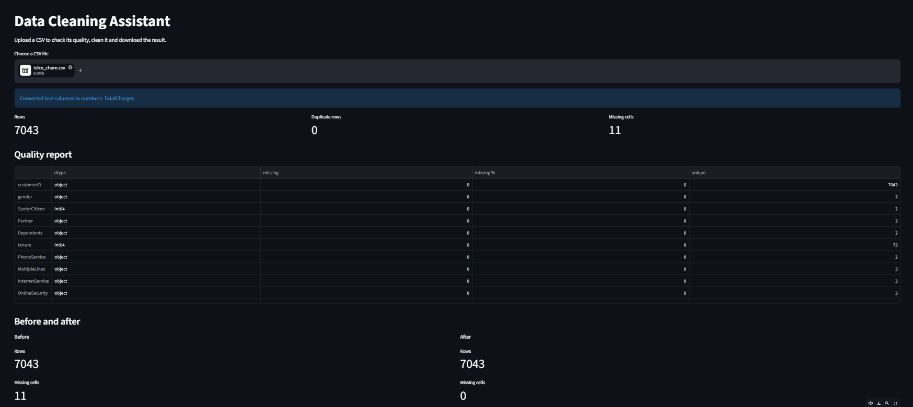

# Data Cleaning Assistant

A small web app that checks a CSV file for common data quality problems, cleans it, and lets you download the result.

  



## What it does

- **Quality report:** data type, missing values, missing % and unique values for every column.
- **Finds hidden problems:** blank cells stored as spaces are treated as missing, and number-like text columns are converted to numbers.
- **Detects duplicates and outliers** (IQR rule; 0/1 columns are skipped).
- **You choose the cleaning:** remove duplicates, trim spaces, fill missing numbers with median or mean, fill missing text with the most common value.
- **Before and after** comparison, then download the cleaned CSV.

## Example: Telco Customer Churn dataset

Uploading the Telco churn data (7,043 rows) showed:
- `TotalCharges` was stored as text because 11 rows were blank spaces.
- The app converted it to numbers, counted 11 missing cells, and filled them with the median.
- Result: 11 missing cells before, 0 after.

## Run it yourself

```
pip install -r requirements.txt
python -m streamlit run app.py
```

## Tech

Python, pandas, Streamlit.

## Limitations and next steps

- Outliers are only flagged, not removed.
- Add charts for missing values.
- Detect dates stored as text.
- Deploy on Streamlit Community Cloud.
